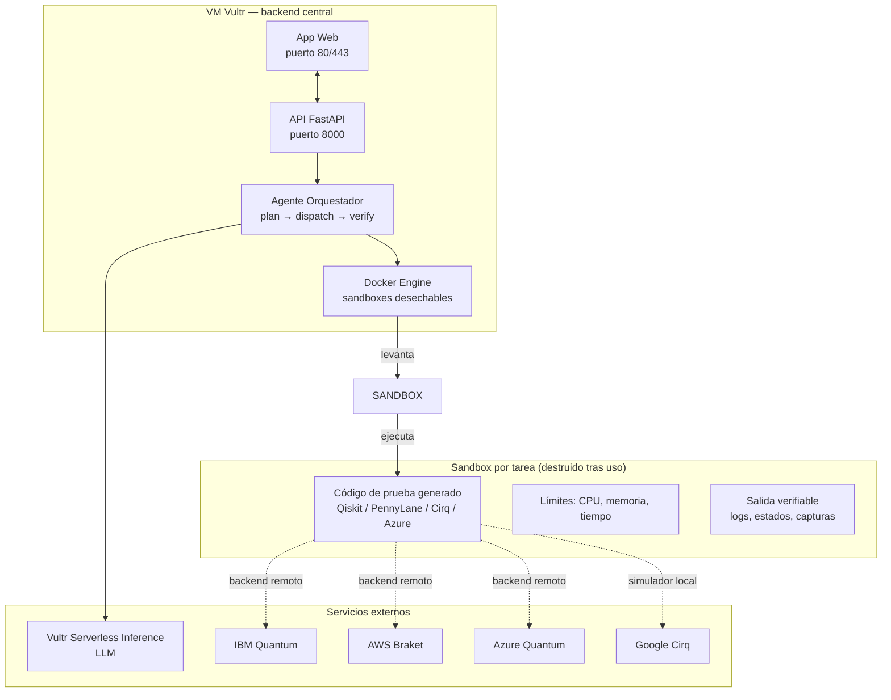
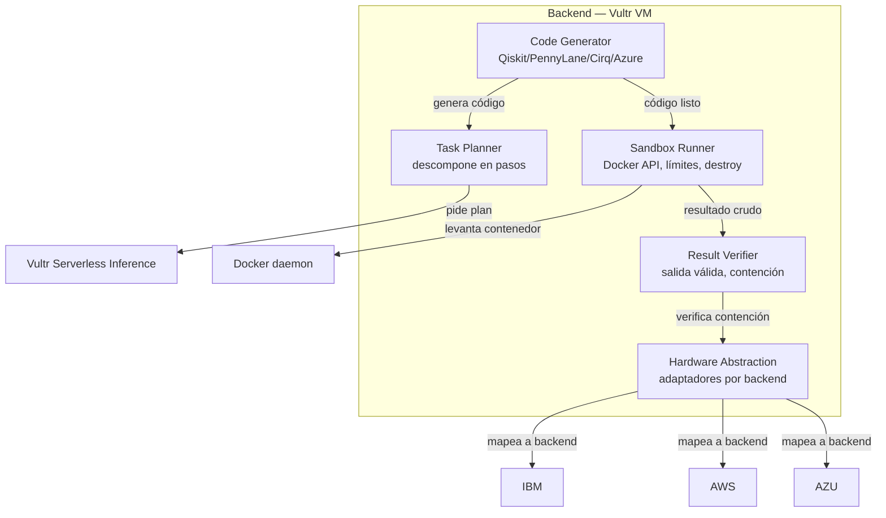
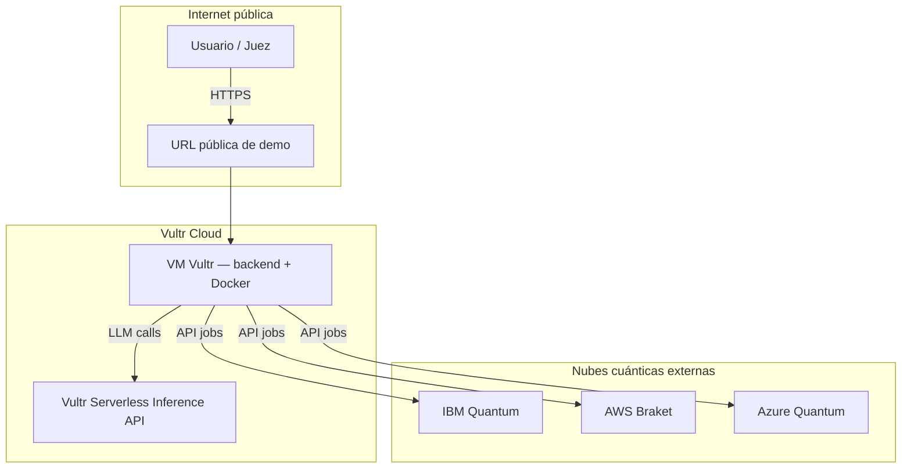

# C4 — Quantum Testing Agent

## Nivel 1 — Contexto (System Context)

```mermaid
graph TB
    subgraph user ["Usuario / Juez"]
        U[Operador web] -->|especifica circuito / prueba| WEB[App Web]
    end

    subgraph vultr ["Vultr Cloud (requerido por el evento)"]
        WEB[App Web / UI] -->|HTTP JSON| API[API Backend FastAPI]
        API -->|plan + llamadas LLM| INF[Vultr Serverless Inference<br/>https://api.vultrinference.com/v1]
        API -->|despliega / destruye| SANDBOX[Docker Sandbox<br/>aislado, límites tiempo/memoria]
        SANDBOX -->|ejecuta código cuántico| QISKIT[Qiskit → IBM Quantum<br/>simulador / hardware remoto]
        SANDBOX -->|ejecuta código cuántico| PENNY[PennyLane → AWS Braket<br/>simulador / hardware remoto]
        SANDBOX -->|ejecuta código cuántico| CIRQ[Cirq → Google Quantum<br/>simulador]
        SANDBOX -->|ejecuta código cuántico| AZURE[Azure Quantum → Microsoft<br/>simulador / hardware remoto]
        SANDBOX -->|simulador local CPU| CPU[Simulador statevector CPU<br/>compat NVIDIA (CUDA-Q) / AMD (ROCm)]
    end

    subgraph cont ["Contención (obligatorio)"]
        SANDBOX -.->|absorbe rm -rf,<br/>bucle infinito,<br/>página hostil| CONTAIN[Contención verificada<br/>en vídeo de demo]
    end

    style user fill:#e1f5e1,color:#006600
    style vultr fill:#1f4e79,color:#fff
    style cont fill:#7d1e1e,color:#fff
```

### Responsabilidades por frontera

| Frontera | Qué hace | Tecnología |
|---|---|---|
| Usuario | Especifica circuito, framework, objetivo de prueba | Navegador web |
| App Web | Recibe especificación, muestra resultado verificable | HTML/JS ligero |
| API Backend | Orquesta planificación, despacho, verificación | Python FastAPI en VM Vultr |
| LLM (Vultr) | Planea tareas, genera código, explica resultados | Vultr Serverless Inference (OpenAI-compatible) |
| Sandbox | Ejecuta código aislado, límites de recursos, destroy tras tarea | Docker en VM Vultr |
| Backends cuánticos | Ejecuta en simulador o hardware remoto | IBM, AWS, Microsoft, Google |
| Simulador local CPU | Fallback sin GPU de Vultr | CUDA-Q (NVIDIA) / ROCm (AMD) / statevector puro |

> Nota: Vultr no tiene GPUs disponibles en este evento. Toda inferencia LLM va por Vultr Serverless Inference; el cómputo cuántico pesado se delega a backends remotos (IBM/AWS/Azure) o al simulador CPU local.

---

## Nivel 2 — Contenedores (Container)



### Descripción de contenedores

| Contenedor | Responsabilidad | Stack |
|---|---|---|
| App Web | UI de entrada y visualización de resultados | HTML/JS (o React ligero) |
| API FastAPI | Endpoints REST: crear tarea, estado, resultado | Python, FastAPI, uvicorn |
| Agente Orquestador | Descompone tarea, genera código, verifica salida | Python, LLM vía Vultr Inference |
| Docker Engine | Levanta/destruye contenedores aislados por tarea | Docker, límites de cgroups |
| Sandbox por tarea | Ejecuta código cuántico con límites estrictos | Imagen Docker mínima con Qiskit/PennyLane/Cirq |

---

## Nivel 3 — Componentes (Component, dentro del backend)



### Responsabilidades de componentes

| Complemento | Qué hace | Entrada | Salida |
|---|---|---|---|
| Task Planner | Descompone "probar este circuito" en pasos ejecutables | Especificación usuario | Lista de pasos |
| Code Generator | Escribe código de prueba en el framework elegido | Paso + framework | Archivo .py |
| Sandbox Runner | Levanta contenedor, aplica límites, ejecuta, destruye | Archivo .py | Salida stdout/stderr, código de salida |
| Result Verifier | Evalúa si la salida es válida y detecta contención | Salida cruda | Resultado verificable + bandera de contención |
| Hardware Abstraction | Normaliza llamadas a IBM/AWS/Azure/Google/local | Resultado | Datos unificados para UI |

---

## Nivel 4 — Código (opcional, se detalla al implementar)

Cada adaptador de framework expone una interfaz común:
```python
class QuantumBackendAdapter:
    def run(self, circuit: str, shots: int) -> TestResult
```
Implementaciones: `QiskitAdapter`, `PennyLaneAdapter`, `CirqAdapter`, `AzureQuantumAdapter`, `LocalCPUSimulatorAdapter`.

---

## 12. Diagrama de despliegue (Deployment)



---

**Tags:** #c4 #arquitectura #quantum #hackaton #vultr
