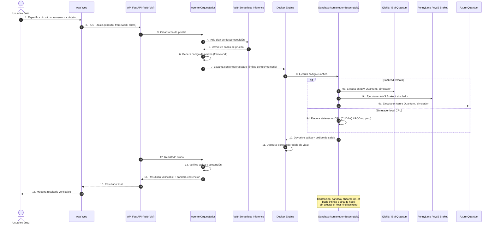

# Workflow — Flujo de trabajo del agente

## Diagrama de secuencia (UML)



## Flujo de estados de la tarea

```
creada -> planificada -> codigo_generado -> sandbox_levantado
   |                                              |
   v                                              v
fallida(plan)                              ejecutando
                                           |
                                           v
                                     completada / fallida(ejecucion)
                                           |
                                           v
                                     verificada -> resultado_listo
```

| Estado | Qué significa | Acción siguiente |
|---|---|---|
| creada | Usuario envió especificación | Planificar con LLM |
| planificada | LLM descompuso en pasos | Generar código |
| codigo_generado | Código de prueba listo | Levantar sandbox |
| sandbox_levantado | Contenedor activo | Ejecutar |
| ejecutando | Código corriendo aislado | Esperar salida |
| completada | Salida válida, dentro de límites | Verificar |
| fallida(ejecucion) | Error de circuito o timeout | Contención activada, reintento opcional |
| verificada | Resultado confirmado y seguro | Devolver a usuario |
| resultado_listo | Disponible en UI | Mostrar veredicto |

## Reglas de contención (obligatorio en el hackathon)

1. **Aislamiento de procesos:** el código cuántico nunca toca el host ni el runtime de la API.
2. **Higiene de secretos:** ninguna API key de IBM/AWS/Azure dentro del sandbox; las claves viven solo en el backend (variables de entorno de la VM).
3. **Límites de recursos:** tope de CPU, memoria y tiempo por contenedor (ej. 60 s, 512 MB).
4. **Disciplina de ciclo de vida:** el contenedor se destruye tras cada tarea, exitoso o fallido.
5. **Momento de contención en demo:** el vídeo debe mostrar el sandbox absorbiendo un `rm -rf`, un bucle infinito o un circuito hostil sin comprometer el sistema.

## Patrones de ejecución (Challenge 1 — Blast Radius Zero)

| Patrón | Qué hace el usuario | Qué hace el agente |
|---|---|---|
| A — Sandboxed code execution | Pide probar un circuito cuántico | Escribe código Qiskit/PennyLane/Cirq/Azure, lo ejecuta en Docker, retorna salida verificada |
| B — Sandboxed browser use | (opcional) Da URL de un dashboard cuántico | Navega con Playwright en contenedor, captura estados, verifica con visión |

**Recomendación para este proyecto:** enfocarse en el Patrón A (ejecución de código cuántico), que es el núcleo del valor y encaja directamente en "Blast Radius Zero".

## Momentos donde el LLM interviene

1. **Planificación:** descomponer la especificación del usuario en pasos de prueba ejecutables.
2. **Generación de código:** escribir el script de prueba en el framework seleccionado.
3. **Explicación de resultados:** traducir estados cuánticos y métricas a lenguaje natural para el usuario/juez.
4. **Verificación de contención:** interpretar si un fallo fue contenido correctamente por el sandbox.

---

**Tags:** #workflow #uml #secuencia #quantum #hackaton #vultr
